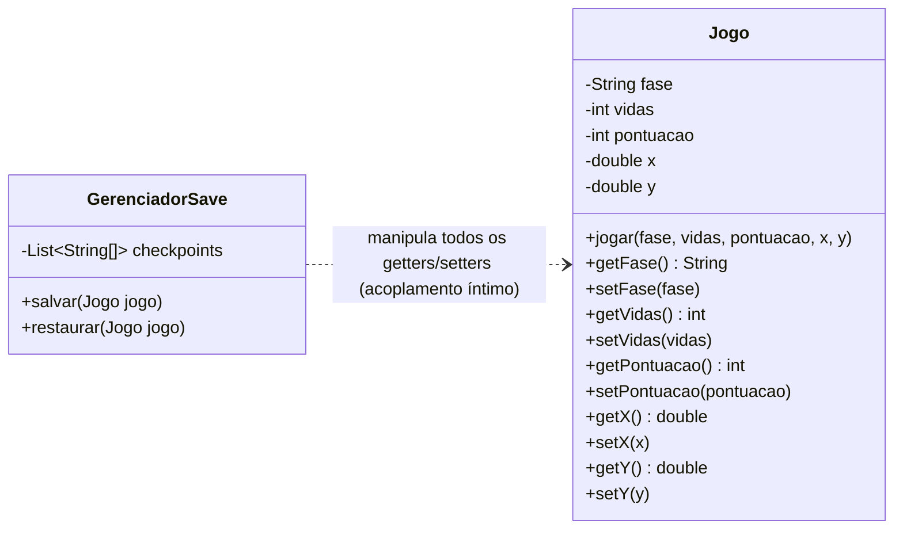

# Jogo Refatorado com o Padrão Memento

Projeto de um jogo com sistema de **Checkpoints** desenvolvido em **Java 17 / Maven**, refatorado a partir de um código legado que apresentava anti-patterns de design (violação de encapsulamento, modelo anêmico e acoplamento forte entre persistência e entidade).

---

## O Problema Original (Anti-Pattern)

No código original:
1. A classe `Jogo` expunha **getters e setters** para todos os seus atributos internos, permitindo manipulação externa direta e quebrando o encapsulamento.
2. O `GerenciadorSave` copiava campo a campo do `Jogo` para um array de strings (`String[]`) sem tipagem, conhecendo a ordem exata de cada dado.
3. Se um novo campo fosse adicionado (ex.: `inimigos`), múltiplos pontos precisavam ser alterados no gerenciador, indicando acoplamento impróprio (*Inappropriate Intimacy*).
4. O histórico em `String[]` acarretava perda de *type safety*, risco de conversões inválidas (`NumberFormatException`) e erros silenciosos se a ordem dos campos fosse invertida.

---

## Solução com o Padrão Memento

A refatoração adotou o padrão **Memento (GoF)**, separando claramente as responsabilidades:

1. **Originator (`Jogo`):**
   - Mantém o estado interno e as regras de domínio do jogo.
   - Não expõe setters públicos.
   - Cria snapshots através do método `salvar()`.
   - Restaura seu estado de forma atômica através do método `restaurar(Checkpoint)`.
2. **Memento (`Checkpoint` / `JogoCheckpoint`):**
   - Implementado como um `record` imutável (`JogoCheckpoint`) privado internamente na classe `Jogo` (Java 17+).
   - Implementa a interface pública vazia `Checkpoint`.
3. **Caretaker (`GerenciadorSave`):**
   - Armazena a pilha (`Deque<Checkpoint>`) de pontos salvos.
   - Não inspeciona nem modifica o conteúdo dos checkpoints.
4. **Interface Estreita vs. Interface Ampla:**
   - **Interface Estreita (*Narrow Interface*):** A interface pública `Checkpoint` não expõe métodos de acesso ao estado, garantindo que o Caretaker seja cego aos dados internos do jogo.
   - **Interface Ampla (*Wide Interface*):** Apenas a classe `Jogo` tem acesso à estrutura concreta do `JogoCheckpoint`, podendo ler seus campos ao restaurar.

---

## Diagramas de Classes

### Antes (Anti-Pattern)


### Depois (Padrão Memento)
```mermaid
classDiagram
    direction LR

    class Checkpoint {
        <<interface>>
        %% Interface Estreita: sem métodos expostos para o Caretaker
    }

    class JogoCheckpoint {
        -String fase
        -int vidas
        -int pontuacao
        -double x
        -double y
        %% Interface Ampla: acessível apenas pelo Jogo
    }
    Checkpoint <|.. JogoCheckpoint : implementa

    class Jogo {
        -String fase
        -int vidas
        -int pontuacao
        -double x
        -double y
        +jogar(fase, vidas, pontuacao, x, y)
        +salvar() Checkpoint
        +restaurar(Checkpoint checkpoint)
    }

    class GerenciadorSave {
        -Deque~Checkpoint~ checkpoints
        +salvar(Checkpoint checkpoint)
        +restaurar() Checkpoint
    }

    Jogo +-- JogoCheckpoint : record privado interno
    Jogo ..> Checkpoint : cria e restaura
    GerenciadorSave o-- Checkpoint : armazena (Caretaker)
```

---

## Como Rodar

O projeto utiliza **Java 17+** e **Maven**:

```bash
# Compilar o projeto
mvn compile

# Executar a classe Main
java -cp target/classes br.venson.net.designpatterns.memento.Main
```

Saída esperada:
```text
Apos salvar:      Jogo{fase=Fase 1, vidas=3, pontuacao=100, x=10.0, y=20.0}
Depois de jogar:  Jogo{fase=Fase 2, vidas=1, pontuacao=450, x=80.0, y=15.0}
Apos restaurar:   Jogo{fase=Fase 1, vidas=3, pontuacao=100, x=10.0, y=20.0}
```
